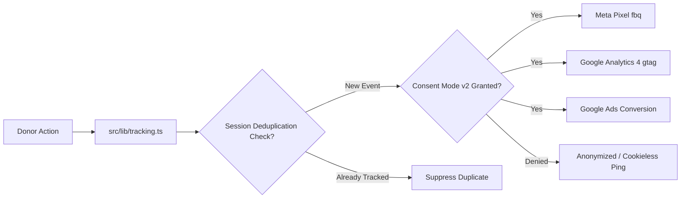

# JANASEVA ASHRAMA — ANALYTICS & CONVERSION TRACKING SETUP GUIDE

**Organization:** JANASEVA ASHRAMA  
**Domain:** [https://www.janasevaashrama.org](https://www.janasevaashrama.org)  
**Tracking Engines Supported:** Meta Pixel, Google Analytics 4 (GA4), Google Ads Conversion Tracking, Google Tag Manager (GTM)  
**Consent Standard:** Google Consent Mode v2  
**Implementation Source:** [`src/lib/tracking.ts`](file:///d:/jana_build/src/lib/tracking.ts) and [`src/components/TrackingScripts.tsx`](file:///d:/jana_build/src/components/TrackingScripts.tsx)  

---

## 1. Architecture Overview

Janaseva Ashrama uses a unified, client-safe event dispatcher that synchronizes donation funnel events simultaneously across Meta Pixel, GA4, and Google Ads without code duplication or vendor lock-in.



### Core Tenets
1. **Zero Raw PII Leaks:** PAN cards, donor email addresses, and phone numbers are strictly scrubbed from marketing event payloads.
2. **Session-Level Idempotency:** Duplicate page reloads on `/thank-you` or receipt pages do not fire duplicate `Purchase` or `Donate` conversion events.
3. **Graceful Fallbacks:** If an environment variable is omitted (e.g., Google Ads ID not yet provisioned), tracking functions silently no-op without throwing JavaScript errors or degrading the user experience.

---

## 2. Environment Variables Configuration

Set these variables in `.env` (or via the Vercel Project Dashboard):

| Variable Name | Required | Example / Description |
|:---|:---:|:---|
| `NEXT_PUBLIC_META_PIXEL_ID` | Optional | `123456789012345` (15-16 digit Meta Pixel ID) |
| `NEXT_PUBLIC_GOOGLE_ADS_ID` | Optional | `AW-123456789` (Google Ads Customer ID) |
| `NEXT_PUBLIC_GOOGLE_ADS_CONVERSION_LABEL` | Optional | `AbCdEfGhIjKlMnOpQr` (Label from Google Ads Conversion Action) |
| `NEXT_PUBLIC_GOOGLE_TAG_MANAGER_ID` | Optional | `GTM-XXXXXXX` (Google Tag Manager Container ID) |

> [!NOTE]
> All tracking IDs use the `NEXT_PUBLIC_` prefix, making them available in client-side bundles while sensitive credentials (database strings, Razorpay secrets) remain protected on the server.

---

## 3. Supported Conversion Events & Mapping

| Funnel Stage | Unified Trigger | Meta Pixel (`fbq`) | Google Analytics 4 (`gtag`) | Google Ads (`gtag`) |
|:---|:---|:---|:---|:---|
| **Page Visit** | Route change | `fbq('track', 'PageView')` | `gtag('event', 'page_view')` | Automatic |
| **Catalog View** | View package | `fbq('track', 'ViewContent', { content_name, value, currency: 'INR' })` | `gtag('event', 'view_item', { items: [...] })` | — |
| **Checkout Start** | Tap Donate / Checkout | `fbq('track', 'InitiateCheckout', { value, currency: 'INR' })` | `gtag('event', 'begin_checkout', { value, items })` | — |
| **Donation Success** | Payment Verified | `fbq('track', 'Donate', { value, currency: 'INR' })` + `Purchase` | `gtag('event', 'purchase', { transaction_id, value })` | `gtag('event', 'conversion', { send_to: 'AW-.../...' })` |

---

## 4. Code Implementation Details

### A. Script Injection & Consent Mode v2 (`src/components/TrackingScripts.tsx`)
Injected in `src/app/layout.tsx` inside `<head>`:
```tsx
// Sets default Consent Mode v2 state before any script execution
window.dataLayer = window.dataLayer || [];
function gtag(){dataLayer.push(arguments);}
gtag('consent', 'default', {
  'ad_storage': 'denied',
  'ad_user_data': 'denied',
  'ad_personalization': 'denied',
  'analytics_storage': 'denied',
  'wait_for_update': 500
});
```

### B. Unified Event Dispatcher (`src/lib/tracking.ts`)

#### 1. Tracking View Content
```typescript
export function trackViewContent(item: { id: string; name: string; amount: number }) {
  if (typeof window === 'undefined') return;

  // Meta Pixel
  if (window.fbq) {
    window.fbq('track', 'ViewContent', {
      content_ids: [item.id],
      content_name: item.name,
      value: item.amount,
      currency: 'INR',
    });
  }

  // Google Analytics 4
  if (window.gtag) {
    window.gtag('event', 'view_item', {
      currency: 'INR',
      value: item.amount,
      items: [{ item_id: item.id, item_name: item.name, price: item.amount }],
    });
  }
}
```

#### 2. Tracking Initiate Checkout
```typescript
export function trackInitiateCheckout(amount: number, items: Array<{ id: string; name: string }>) {
  if (typeof window === 'undefined') return;

  if (window.fbq) {
    window.fbq('track', 'InitiateCheckout', {
      value: amount,
      currency: 'INR',
      content_ids: items.map(i => i.id),
      num_items: items.length,
    });
  }

  if (window.gtag) {
    window.gtag('event', 'begin_checkout', {
      currency: 'INR',
      value: amount,
      items: items.map(i => ({ item_id: i.id, item_name: i.name })),
    });
  }
}
```

#### 3. Tracking Donation Success with Deduplication
```typescript
export function trackDonationSuccess(donation: {
  id: string;
  amount: number;
  campaignTitle?: string;
}) {
  if (typeof window === 'undefined') return;

  // Session storage idempotency guard
  if (isDonationTracked(donation.id)) {
    console.info(`[Tracking] Donation ${donation.id} already tracked in this session. Suppressing duplicate.`);
    return;
  }

  // Meta Pixel
  if (window.fbq) {
    window.fbq('track', 'Donate', {
      value: donation.amount,
      currency: 'INR',
      content_name: donation.campaignTitle || 'General Support',
    });
    window.fbq('track', 'Purchase', {
      value: donation.amount,
      currency: 'INR',
      transaction_id: donation.id,
    });
  }

  // Google Analytics 4
  if (window.gtag) {
    window.gtag('event', 'purchase', {
      transaction_id: donation.id,
      value: donation.amount,
      currency: 'INR',
      items: [{
        item_id: donation.id,
        item_name: donation.campaignTitle || 'General Support',
        price: donation.amount,
      }],
    });

    // Google Ads Conversion Action
    const adsId = process.env.NEXT_PUBLIC_GOOGLE_ADS_ID;
    const label = process.env.NEXT_PUBLIC_GOOGLE_ADS_CONVERSION_LABEL;
    if (adsId && label) {
      window.gtag('event', 'conversion', {
        send_to: `${adsId}/${label}`,
        value: donation.amount,
        currency: 'INR',
        transaction_id: donation.id,
      });
    }
  }

  // Mark tracked
  markDonationTracked(donation.id);
}
```

---

## 5. Session-Level Deduplication Engine

To ensure that reporting metrics reflect genuine revenue without inflation caused by browser refreshes or back-button clicks:
- When a donation is tracked, its `donation.id` is added to a `sessionStorage` set under `tracked_donations`.
- Subsequent evaluations of `trackDonationSuccess(donation)` check whether `donation.id` exists in `sessionStorage`.
- If already present, tracking is cleanly bypassed with an informational console log.

---

## 6. Testing & Quality Assurance

### A. Verifying with Meta Pixel Helper (Chrome Extension)
1. Open [https://www.janasevaashrama.org](https://www.janasevaashrama.org).
2. The Meta Pixel Helper icon should turn green and show `PageView`.
3. Select an impact preset (e.g., ₹4,500 Daily Meals) and click Donate.
4. Verify `InitiateCheckout` event fires with `currency: "INR"` and `value: 4500`.
5. Upon test payment confirmation, verify `Donate` and `Purchase` events fire.
6. Refresh the thank-you page: verify that NO duplicate `Purchase` event is fired.

### B. Verifying with Google Tag Assistant & GA4 DebugView
1. Open Google Tag Assistant and connect to `https://www.janasevaashrama.org`.
2. Inspect the live data layer:
   - Verify `begin_checkout` carries `value` and `items`.
   - Verify `purchase` carries `transaction_id`, `value`, and `currency: 'INR'`.
   - Verify Google Ads `conversion` fires with `send_to: AW-.../...`.

---

## 7. Data Privacy & Compliance Sign-off

- **PAN Card Excluded:** Donors' Indian PAN numbers are strictly processed by `/api/donations/verify` on the server and printed exclusively on Section 80G tax receipts. They are **never** passed into `window.fbq` or `window.gtag`.
- **Donor Contact Excluded:** Plain-text phone numbers and email addresses are omitted from marketing payloads.
- **Child Privacy:** No child identities, personal details, or sensitive case files are tagged in any analytics payload.
