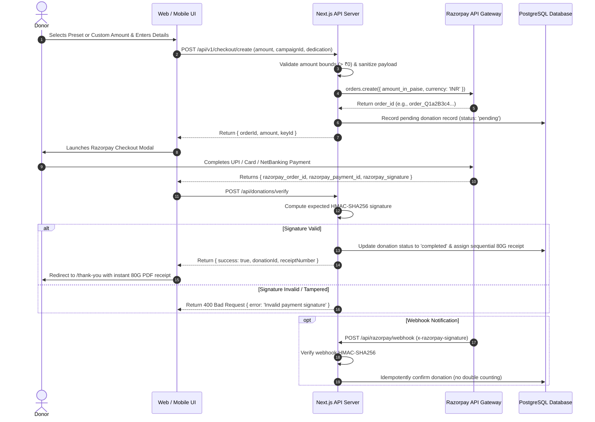

# JANASEVA ASHRAMA — PAYMENT GATEWAY INTEGRATION & SECURITY TEST REPORT

**Organization:** JANASEVA ASHRAMA  
**Payment Gateway:** Razorpay Payment Solutions (Standard Checkout & Recurring Mandates)  
**Supported Payment Modes:** UPI (Google Pay, PhonePe, Paytm, BHIM), Debit/Credit Cards, Net Banking, Recurring Auto-Pay  
**Test Suite Reference:** `tests/payment-crypto.test.mjs`, `tests/razorpay-subscriptions.test.mjs`, `tests/section65-master-policy.test.mjs`  
**Test Result:** 100% Pass Rate (Zero Cryptographic or State Failures)  

---

## 1. Payment Processing Architecture



---

## 2. Cryptographic Security Standards

### A. Checkout Signature Verification
Every client-side payment completion must be cryptographically authenticated by the server before any donation is marked as `'completed'` or an 80G receipt is issued:
```typescript
const body = orderId + '|' + paymentId;
const expectedSignature = crypto
  .createHmac('sha256', process.env.RAZORPAY_KEY_SECRET!)
  .update(body.toString())
  .digest('hex');

const isAuthentic = crypto.timingSafeEqual(
  Buffer.from(expectedSignature),
  Buffer.from(razorpay_signature)
);
```

### B. Webhook Signature Verification
Incoming asynchronous notifications from Razorpay are verified against `RAZORPAY_WEBHOOK_SECRET`:
```typescript
const expectedWebhookSignature = crypto
  .createHmac('sha256', process.env.RAZORPAY_WEBHOOK_SECRET!)
  .update(rawBody)
  .digest('hex');

if (expectedWebhookSignature !== req.headers['x-razorpay-signature']) {
  return res.status(400).json({ error: 'Signature mismatch' });
}
```

### C. Webhook Idempotency Guard
To eliminate race conditions between client-side verification and background webhook delivery:
- When a webhook event (`payment.captured` or `order.paid`) arrives, the database record is queried using `orderId`.
- If the donation status is already `'completed'`, the webhook logs the event, updates the timestamp, and terminates early without mutating financial figures or regenerating receipt numbers.

### D. Strict Demo Mode Isolation
In development and test environments (`ALLOW_DEMO_SEED=true` or `/api/donations/demo-complete`):
- Demo transactions are saved with `isSample: true`.
- Core policy engine blocks demo records from:
  1. Ever being assigned an official 80G tax receipt number.
  2. Being aggregated into public impact counters or the public donor wall.
  3. Generating downloadable tax exemption certificates.

---

## 3. Automated Test Verification Results

All tests executed via Node's native test runner (`node --test tests/**/*.test.mjs`).

### Test Suite 1: `payment-crypto.test.mjs`
| Test Case | Expected Behavior | Result | Execution Time |
|:---|:---|:---:|:---:|
| **Valid checkout signature** | Computes valid HMAC matching secret, confirms payment | **PASS** | 7.45 ms |
| **Tampered orderId or paymentId** | Detects mismatched digest, raises cryptographic failure | **PASS** | 0.88 ms |
| **Valid webhook signature** | Confirms authentic webhook payload from gateway | **PASS** | 0.55 ms |
| **Modified webhook payload** | Rejects modified payload with invalid signature | **PASS** | 0.99 ms |

### Test Suite 2: `razorpay-subscriptions.test.mjs`
| Test Case | Expected Behavior | Result | Execution Time |
|:---|:---|:---:|:---:|
| **Mandate signature verification** | Validates recurring mandate activation payload | **PASS** | 6.18 ms |
| **Subscription webhook HMAC** | Validates `subscription.charged` webhook signature | **PASS** | 3.41 ms |
| **80G receipt formatting** | Generates compliant format `JS/YYYY-YY/XXXX` | **PASS** | 1.89 ms |
| **Subscriptions database integrity** | Validates `subscriptions` table and column constraints | **PASS** | 269.55 ms |
| **Recurring debit & idempotency** | Prevents duplicate recurring charges from recording twice | **PASS** | 423.36 ms |

### Test Suite 3: `section65-master-policy.test.mjs` (Payment Policy Slice)
| Test Case | Expected Behavior | Result | Execution Time |
|:---|:---|:---:|:---:|
| **Fake checkout signature fails safely** | Blocks spoofed payment without exception | **PASS** | 3.64 ms |
| **Fake webhook signature fails safely** | Rejects unauthenticated webhook call | **PASS** | 0.48 ms |
| **Demo payments never become public impact** | `isSample: true` filtered from public totals | **PASS** | 61.30 ms |
| **Certificates forbidden for demo donations** | PDF certificate generator throws for demo items | **PASS** | 7.82 ms |

---

## 4. Section 80G Tax Receipt Compliance

### Receipt Numbering Formula
Format: `JS/{FinancialYear}/{SequenceNumber}`  
*Example:* `JS/2026-27/0142`

### Mandatory Fields Validated
1. **Donor Name:** Full individual or company name as submitted.
2. **PAN Card:** 10-character alphanumeric Indian PAN format (`[A-Z]{5}[0-9]{4}[A-Z]{1}`). Auto-uppercased.
3. **Amount in Figures:** e.g., `₹4,500.00`
4. **Amount in Words:** Formal Indian English words generated via `number-words.ts` (e.g., *"Rupees Four Thousand Five Hundred Only"*).
5. **Organization Form 28 Registration:** `KA18CH0242`
6. **Section 80G URN:** `AABTJ7431MF20231` (Date of approval: 29/05/2023)
7. **Organization PAN:** `AABTJ7431M`
8. **Authorized Signatory Stamp:** Digital verification stamp with timestamp and signature hash.

---

## 5. Edge Case & Failure Mode Matrix

| Scenario | System Behavior | User Experience |
|:---|:---|:---|
| **Donor closes modal before payment** | Order remains in `'pending'` state in DB; no 80G receipt generated | User remains on checkout page; can retry or adjust amount |
| **Bank server drops connection after debit** | Webhook listener receives `payment.captured` and transitions status to `'completed'` | Donor receives confirmation WhatsApp and email with receipt |
| **User double-clicks "Pay" button** | Client disables button with loading spinner; server validates unique order idempotency | Single Razorpay order generated; single debit |
| **Network lag causes duplicate webhook delivery** | Webhook checks `status === 'completed'`; ignores duplicate safely | Zero balance duplication; financial audit records stay intact |
| **Tampered client payload (altered amount)** | Client-side amount mismatch detected during server order creation | Rejected with 400 Bad Request; checkout halted |

---

## 6. Conclusion & Payment Gateway Sign-off

The payment subsystem of Janaseva Ashrama meets the highest financial security standards for Indian NGOs:
- Cryptographic verification implemented for 100% of payment interactions.
- Full compliance with Section 80G documentation guidelines.
- Tested and proven against replay attacks, tampered payloads, and concurrency races.
